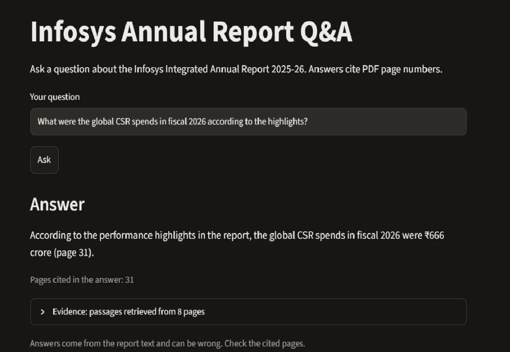

# Infosys Annual Report Q&A (RAG)
**Live demo:** https://infosysragchatbot-hjrousbkkcqwkoutdrxbm2.streamlit.app/

A question-answering system over the Infosys Integrated Annual Report 2025-26 (383 pages). It finds the relevant passages with hybrid search, asks Gemini to answer using only those passages, cites the PDF pages used, and says "I could not find this in the report" when the answer is not there.

## How it works

1. **Extract** text from each PDF page and split it into chunks (1,000 characters, 200 overlap), keeping the page number.
2. **Embed** every chunk with `all-MiniLM-L6-v2` (sentence embeddings) for search by meaning.
3. **Index** the same chunks with BM25 for keyword search.
4. **Retrieve** with both methods and merge the rankings (reciprocal rank fusion). Top 10 chunks go to the model.
5. **Answer** with Gemini, instructed to use only the supplied text and to cite page numbers.
6. **Streamlit app** shows the answer, the cited pages and the evidence passages.

   

## Evaluation

I wrote a test set of 17 questions with known answers and page numbers (verified in the PDF), plus 4 questions that are not in the report. I changed one thing at a time and re-ran the same test.

| Setup | Correct answers | Refusals (out-of-scope) |
|---|---|---|
| Semantic search only, 5 chunks | 12 / 17 | 4 / 4 |
| Hybrid search (semantic + BM25), 5 chunks | 14 / 17 | 4 / 4 |
| Hybrid search, 10 chunks | 16 / 17 | 4 / 4 |

Findings:
- Every failure in the early setups was a retrieval miss: the right page never reached the model, and it correctly said it could not find the answer instead of guessing.
- The one remaining failure (free cash flow) is a text-extraction problem. On the infographic page, labels and values come out of the PDF separately, so the pairing between them is lost.

## Limitations

- Small test set (17 questions, 10 of them from one summary page). A single question moves the score by about 6 points.
- I chose the number of retrieved chunks after seeing failures on this same set, so the final score is probably optimistic. A held-out set would be the proper check.
- Fixed-length chunks can start or end mid-sentence. Sentence-aware chunking would be a next step.
- Infographic and table-heavy pages extract poorly. Layout-aware extraction is another next step.
- Answers are generated by a language model and can be wrong. Check the cited pages.

## Run it locally

```
pip install -r requirements.txt
set GEMINI_API_KEY=your_key_here
streamlit run rag_app_v2.py
```

Use `export GEMINI_API_KEY=your_key_here` on Mac or Linux. Python 3.10 or newer is recommended. Get a free key at [Google AI Studio](https://aistudio.google.com). The key is read from the environment or Streamlit secrets and is never stored in this repository.

## Files

| File | Purpose |
|---|---|
| `Infosys_RAG.ipynb` | Notebook: extraction, chunking, embeddings, search, evaluation |
| `rag_app_v2.py` | Streamlit app |
| `chunks.json`, `embeddings.npy` | Pre-computed chunks and their embeddings |
| `requirements.txt` | Python dependencies |

The source document is the [Infosys Integrated Annual Report 2025-26](https://www.infosys.com/investors.html) (public).

## Tech stack

Python, sentence-transformers, fastembed, rank_bm25, NumPy, Google Gemini API, Streamlit.
